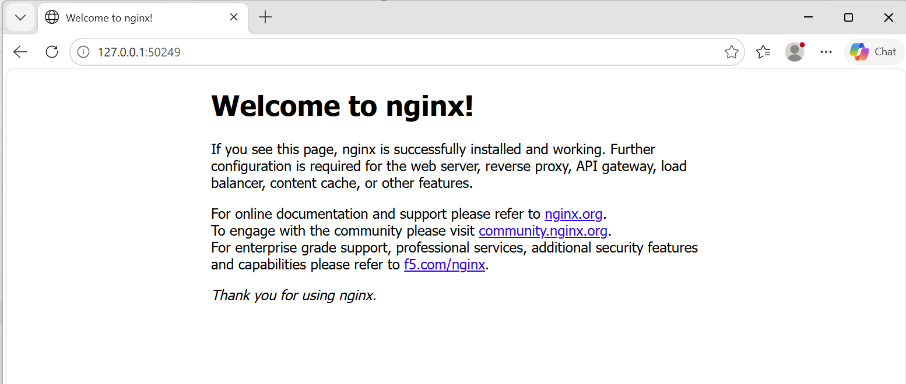

# Exercise 1: Hello Pod

**Goal:** Run your first app inside Kubernetes and access it.

## Steps

1. Start a local Kubernetes cluster:
   ```bash
   minikube start --driver=docker
   ```

2. Create the first Pod (Nginx image):
   ```bash
   kubectl run hello-k8s --image=nginx --port=80
   ```

3. Verify the Pod is running:
   ```bash
   kubectl get pods
   ```

4. Expose the Pod as a Service:
   ```bash
   kubectl expose pod hello-k8s --type=NodePort --port=80
   ```

5. Open the app in the browser:
   ```bash
   minikube service hello-k8s
   ```

## Result

```
PS C:\WINDOWS\System32> minikube start --driver=docker
* minikube v1.39.0 on Microsoft Windows 11 Home 25H2
* Using the docker driver based on user configuration
* Using Docker Desktop driver with root privileges
* Starting "minikube" primary control-plane node in "minikube" cluster
* Pulling base image v0.0.51 ...
* Downloading Kubernetes v1.37.0 preload ...
* Creating docker container (CPUs=2, Memory=4000MB) ...
* Preparing Kubernetes v1.37.0 on containerd 2.3.4 ...
* Configuring CNI (Container Networking Interface) ...
* Verifying Kubernetes components...
* Enabled addons: storage-provisioner, default-storageclass
* Done! kubectl is now configured to use "minikube" cluster and "default" namespace by default

PS C:\WINDOWS\System32> kubectl get nodes
NAME       STATUS     ROLES           AGE   VERSION
minikube   NotReady   control-plane   41s   v1.37.0

PS C:\WINDOWS\System32> kubectl get nodes
NAME       STATUS   ROLES           AGE   VERSION
minikube   Ready    control-plane   74s   v1.37.0

PS C:\WINDOWS\System32> kubectl run hello-k8s --image=nginx --port=80
pod/hello-k8s created

PS C:\WINDOWS\System32> kubectl get pods
NAME        READY   STATUS         RESTARTS   AGE
hello-k8s   0/1     ErrImagePull   0          10s

PS C:\WINDOWS\System32> kubectl expose pod hello-k8s --type=NodePort --port=80
service/hello-k8s exposed

PS C:\WINDOWS\System32> minikube service hello-k8s
|-----------|-----------|-------------|---------------------------|
| NAMESPACE |   NAME    | TARGET PORT |            URL            |
|-----------|-----------|-------------|---------------------------|
| default   | hello-k8s |          80 | http://192.168.49.2:31434 |
|-----------|-----------|-------------|---------------------------|
* Starting tunnel for service hello-k8s.
|-----------|-----------|-------------|------------------------|
| NAMESPACE |   NAME    | TARGET PORT |          URL           |
|-----------|-----------|-------------|------------------------|
| default   | hello-k8s |             | http://127.0.0.1:50249 |
|-----------|-----------|-------------|------------------------|
* Opening service default/hello-k8s in default browser...
```

Browser opened at `http://127.0.0.1:50249` showing the standard "Welcome to nginx!" page — confirmed working.



## Notes

- `kubectl get nodes` showed `NotReady` right after `minikube start` finished — this is normal, the node just needs a few seconds for the CNI/kubelet to finish initializing. A second `kubectl get nodes` a bit later showed `Ready`.
- Right after `kubectl run`, the pod briefly showed `ErrImagePull` while the `nginx` image was still being pulled — resolved on its own once the pull finished (should show `Running` on a later `kubectl get pods`).
- On Windows with the Docker driver, `minikube service` needs a tunnel (`minikube service` output showed "Starting tunnel for service...") and the terminal running it must stay open for the tunnel/service to stay reachable.
- What each command does:
  - `minikube start` — spins up a local single-node Kubernetes cluster inside a Docker container.
  - `kubectl run` — creates a Pod running the given container image.
  - `kubectl get pods` — lists Pods and their status.
  - `kubectl expose` — creates a Service that routes traffic to the Pod (NodePort = reachable from outside the cluster on a high port).
  - `minikube service` — opens/tunnels the Service's URL so it's reachable from the host browser.
