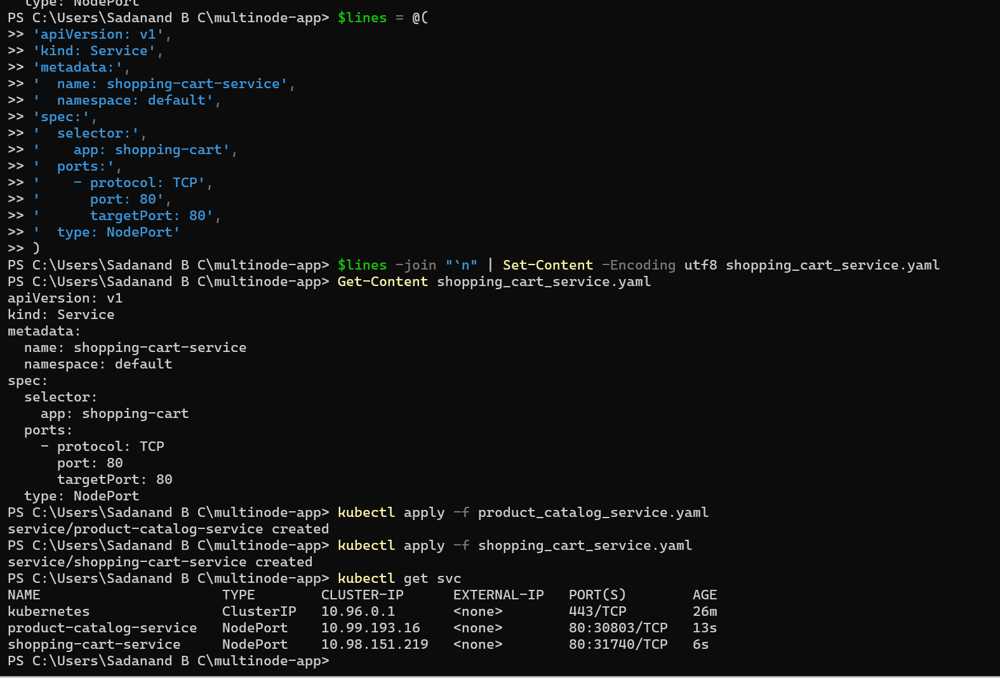
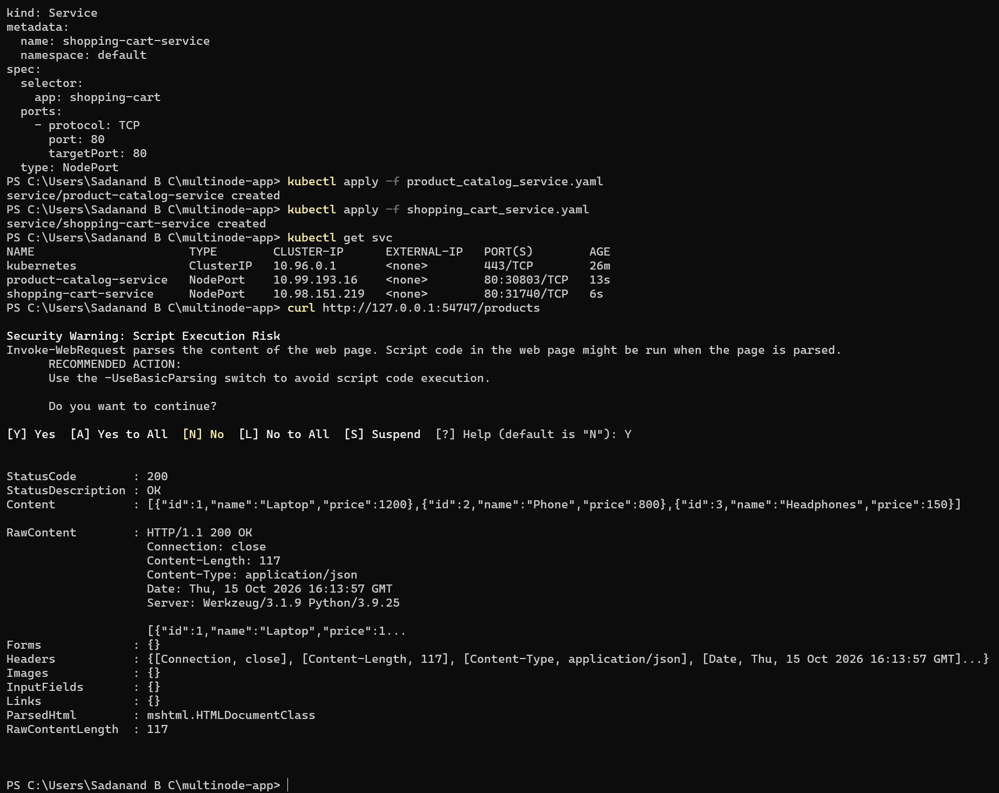
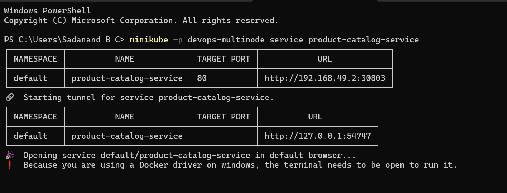
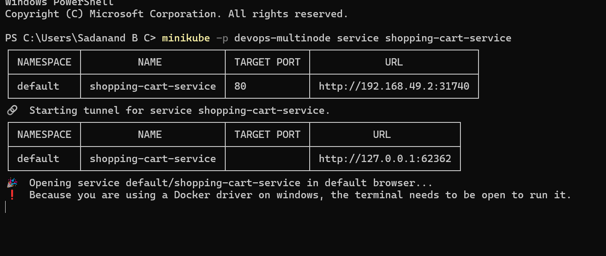
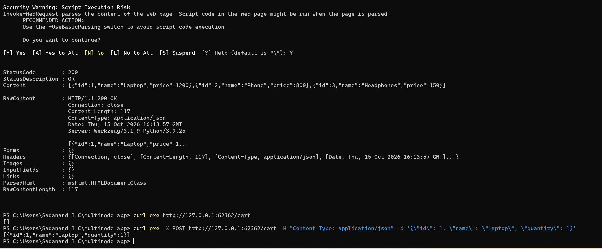

# Exercise 10: Multi-Node Kubernetes Cluster with Multiple Applications and ReplicaSets

**Scenario:** An e-commerce platform with two microservices — Product Catalog (AppA) and Shopping Cart (AppB) — deployed on a 3-node Minikube cluster. Product Catalog runs 2 replicas, Shopping Cart runs 3 replicas, and pod anti-affinity rules ensure no two replicas of the same app land on the same node, so a single node failure can't take out a whole service.

**Files:**
- `exercise10/product_catalog.py`, `exercise10/shopping_cart.py` — the two Flask microservices
- `exercise10/Dockerfile.product`, `exercise10/Dockerfile.shopping` — Docker images for each
- `exercise10/product_catalog_deployment.yaml`, `exercise10/shopping_cart_deployment.yaml` — Deployments with `podAntiAffinity`
- `exercise10/product_catalog_service.yaml`, `exercise10/shopping_cart_service.yaml` — NodePort Services

**Scope note — two deliberate corrections to the manual:**
1. The manual's own `shopping_cart_deployment.yaml` snippet uses `namespace: devops-exercise`, while its `shopping_cart_service.yaml` snippet uses `namespace: default` — a Service can only select pods in its own namespace, so as written the two wouldn't ever find each other. I deployed both apps into `default` consistently instead (which also matches what `product_catalog_deployment.yaml` already used).
2. The manual's verification step for images loaded into the cluster uses `minikube ssh -- docker images`. This cluster's nodes (Minikube v1.37.0) run **containerd**, not Docker, as the node-level runtime — `docker images` inside the node fails with "Cannot connect to the Docker daemon". Used `minikube ssh -- sudo crictl images` instead, which is the containerd-native equivalent and confirmed both custom images were present.

## Steps

1. Clean up any pre-existing Minikube state and start a fresh 3-node cluster under a dedicated profile:
   ```bash
   minikube start --nodes 3 -p devops-multinode --force
   minikube -p devops-multinode addons enable registry
   ```
2. Write `product_catalog.py` and `shopping_cart.py` (Flask apps) and `Dockerfile.product` / `Dockerfile.shopping`.
3. Build both images and load them into the cluster (registry addon, since multi-node can't use `docker-env`):
   ```bash
   docker build -t product-catalog:latest -f Dockerfile.product .
   docker build -t shopping-cart:latest -f Dockerfile.shopping .
   minikube -p devops-multinode image load product-catalog:latest
   minikube -p devops-multinode image load shopping-cart:latest
   ```
4. Write and apply `product_catalog_deployment.yaml` (2 replicas) and `shopping_cart_deployment.yaml` (3 replicas), each with a `podAntiAffinity` rule keyed on `kubernetes.io/hostname`:
   ```bash
   kubectl apply -f product_catalog_deployment.yaml
   kubectl apply -f shopping_cart_deployment.yaml
   ```
5. Verify pod spread across nodes:
   ```bash
   kubectl get pods -o wide
   ```
6. Write and apply `product_catalog_service.yaml` and `shopping_cart_service.yaml` (both `NodePort`, both `namespace: default`):
   ```bash
   kubectl apply -f product_catalog_service.yaml
   kubectl apply -f shopping_cart_service.yaml
   ```
7. Open tunnels to each service (Docker driver on Windows requires a running tunnel per service) and test with `curl`:
   ```bash
   minikube -p devops-multinode service product-catalog-service
   minikube -p devops-multinode service shopping-cart-service
   curl.exe http://127.0.0.1:<product-port>/products
   curl.exe http://127.0.0.1:<cart-port>/cart
   curl.exe -X POST http://127.0.0.1:<cart-port>/cart -H "Content-Type: application/json" -d '{\"id\": 1, \"name\": \"Laptop\", \"quantity\": 1}'
   ```

## Notes — real bugs hit along the way

**Stale 2-node profile blocked the 3-node start.** The first `minikube start --nodes 3 -p devops-multinode --force` printed "You cannot change the number of nodes for an existing minikube cluster" — a `devops-multinode` profile already existed with only 2 nodes (confirmed via `minikube profile list` showing `NODES: 2`), left over from an earlier attempt. The manual's Step 0 cleanup (`minikube stop` / `minikube delete`, no `-p` flag) only ever touches the *default* profile, so it never cleaned this one up. Fixed with `minikube delete -p devops-multinode`, then re-running `minikube start --nodes 3 -p devops-multinode --force`, confirmed via `minikube profile list` showing `NODES: 3`.

**PowerShell here-string hung on paste.** Tried the same `@"..."@` here-string technique from Exercise 9 to write `product_catalog.py`, but the terminal got stuck at a `>>` continuation prompt even after pasting the closing `"@` line — almost certainly a stray character breaking the exact-first-two-characters rule PowerShell needs for a here-string's closing delimiter. Cancelled with Ctrl+C, confirmed nothing had actually been written to the file, and switched to a more robust technique for every file in this exercise: build an array of quoted strings line-by-line, then `$lines -join "`n" | Set-Content -Encoding utf8 <file>`. This worked reliably for every file (`.py`, `Dockerfile.*`, `.yaml`) for the rest of the exercise.

**`minikube ssh -- docker images` failed on the nodes.** Covered in the Scope note above — this Minikube version's nodes run containerd, not Docker, so the manual's verification command doesn't apply here. `minikube ssh -- sudo crictl images` is the correct equivalent for this version and confirmed both `product-catalog:latest` and `shopping-cart:latest` were loaded.

**`kubectl apply -f product_catalog_deployment.yaml` run twice by habit.** The second run just reported `unchanged` — no real issue, just an extra keystroke, noted here for honesty rather than treated as a separate bug.

**PowerShell's `curl` isn't curl.** `curl` in PowerShell is aliased to `Invoke-WebRequest`, not the real curl binary — the first test against the Product Catalog service triggered a "Security Warning: Script Execution Risk / Do you want to continue?" prompt, because `Invoke-WebRequest` tries to parse the response as a web page, and its output comes back as a `.NET` object (`StatusCode`, `Content`, `RawContent`, etc.) rather than plain text. Confirming with `Y` still worked and the `Content` field showed the correct JSON. For the Shopping Cart tests, switched to `curl.exe` (the actual curl binary bundled with Windows) to get plain JSON output with no prompt.

## Result

**3-node cluster confirmed, both apps deployed, all 5 pods `Running` and spread across nodes per the anti-affinity rule:**

```
NAME                               READY   STATUS    RESTARTS   AGE    IP           NODE                   NOMINATED NODE   READINESS GATES
product-catalog-7cb85d4f-mnntc     1/1     Running   0          3m36s  10.244.1.4   devops-multinode-m02   <none>           <none>
product-catalog-7cb85d4f-njdcd     1/1     Running   0          3m36s  10.244.2.4   devops-multinode-m03   <none>           <none>
shopping-cart-6858b5f797-bzz7q     1/1     Running   0          7s     10.244.0.3   devops-multinode       <none>           <none>
shopping-cart-6858b5f797-fk9h      1/1     Running   0          7s     10.244.1.5   devops-multinode-m02   <none>           <none>
shopping-cart-6858b5f797-wt58b     1/1     Running   0          7s     10.244.2.5   devops-multinode-m03   <none>           <none>
```

Product Catalog's 2 pods are on `m02` and `m03`; Shopping Cart's 3 pods are spread across all 3 nodes (`devops-multinode`, `m02`, `m03`) — no two pods of the same app ever share a node.



**Services created as `NodePort`:**

```
NAME                       TYPE        CLUSTER-IP      EXTERNAL-IP   PORT(S)        AGE
product-catalog-service    NodePort    10.99.193.16    <none>        80:30803/TCP   13s
shopping-cart-service      NodePort    10.98.151.219   <none>        80:31740/TCP   6s
```



**Service tunnels opened via `minikube service`:**





**`curl` tests — Product Catalog:**
```
curl http://127.0.0.1:54747/products
Content: [{"id":1,"name":"Laptop","price":1200},{"id":2,"name":"Phone","price":800},{"id":3,"name":"Headphones","price":150}]
```

**`curl` tests — Shopping Cart (empty cart, then add item):**
```
curl.exe http://127.0.0.1:62362/cart
[]
curl.exe -X POST http://127.0.0.1:62362/cart -H "Content-Type: application/json" -d '{\"id\": 1, \"name\": \"Laptop\", \"quantity\": 1}'
[{"id":1,"name":"Laptop","quantity":1}]
```



## Expected Outputs — confirmed

1. **3-node Minikube cluster running under a dedicated profile:** confirmed — `devops-multinode` with `m01`/`m02`/`m03`-equivalent nodes, registry addon enabled.
2. **Both Flask apps Dockerized, built, and loaded into the cluster:** confirmed via `crictl images` (containerd-native check, since this version's nodes don't run Docker).
3. **Deployments applied with `podAntiAffinity`, replicas spread one-per-node:** confirmed — 2 Product Catalog pods on 2 different nodes, 3 Shopping Cart pods on 3 different nodes.
4. **Services exposed as `NodePort` and reachable via `minikube service` tunnels:** confirmed — both tunnels opened successfully with working `127.0.0.1` URLs.
5. **Product Catalog returns the expected product list:** confirmed.
6. **Shopping Cart starts empty and accepts a POST to add an item:** confirmed.
