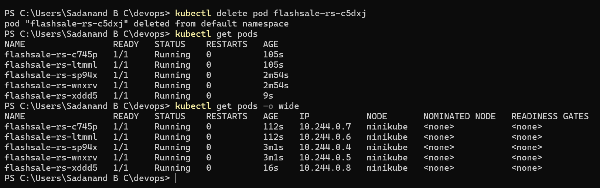
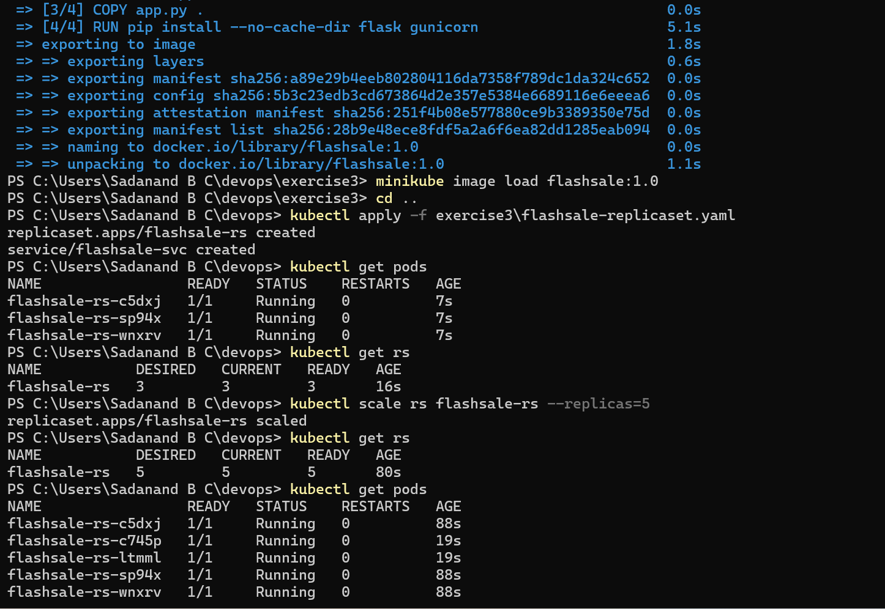

# Exercise 3: Scaling a Flask App with ReplicaSets

**Scenario:** An e-commerce flash sale app needs to handle a sudden spike in traffic. A single Pod would crash under load — a ReplicaSet keeps several identical copies running and automatically replaces any that die.

## Files
- [`exercise3/app.py`](exercise3/app.py) — Flask "flash sale" app with `/` (welcome), `/buy` (simulated checkout, shows which Pod served it), `/health` (for probes)
- [`exercise3/Dockerfile`](exercise3/Dockerfile) — builds the app with gunicorn
- [`exercise3/flashsale-replicaset.yaml`](exercise3/flashsale-replicaset.yaml) — a ReplicaSet (3 replicas) + ClusterIP Service

## Steps

1. Clean slate — reset Minikube to a single node:
   ```bash
   minikube stop
   minikube delete
   minikube start --nodes=1 --driver=docker
   ```

2. Build and load the image:
   ```bash
   cd exercise3
   docker build -t flashsale:1.0 .
   minikube image load flashsale:1.0
   cd ..
   ```

3. Apply the ReplicaSet + Service:
   ```bash
   kubectl apply -f exercise3/flashsale-replicaset.yaml
   ```

4. Verify the 3 pods and the ReplicaSet:
   ```bash
   kubectl get pods
   kubectl get rs
   ```

5. Scale up to 5 replicas:
   ```bash
   kubectl scale rs flashsale-rs --replicas=5
   kubectl get rs
   kubectl get pods
   ```

6. Kill one pod and watch Kubernetes replace it automatically:
   ```bash
   kubectl delete pod <pod-name>
   kubectl get pods
   ```

7. See pod distribution across nodes:
   ```bash
   kubectl get pods -o wide
   ```

## Result

```
PS> kubectl apply -f exercise3\flashsale-replicaset.yaml
replicaset.apps/flashsale-rs created
service/flashsale-svc created

PS> kubectl get pods
NAME                  READY   STATUS    RESTARTS   AGE
flashsale-rs-c5dxj    1/1     Running   0          7s
flashsale-rs-sp94x    1/1     Running   0          7s
flashsale-rs-wnxrv    1/1     Running   0          7s

PS> kubectl get rs
NAME           DESIRED   CURRENT   READY   AGE
flashsale-rs   3         3         3       16s
```



```
PS> kubectl scale rs flashsale-rs --replicas=5
replicaset.apps/flashsale-rs scaled

PS> kubectl get rs
NAME           DESIRED   CURRENT   READY   AGE
flashsale-rs   5         5         5       80s

PS> kubectl get pods
NAME                  READY   STATUS    RESTARTS   AGE
flashsale-rs-c5dxj    1/1     Running   0          88s
flashsale-rs-c745p    1/1     Running   0          19s
flashsale-rs-ltmml    1/1     Running   0          19s
flashsale-rs-sp94x    1/1     Running   0          88s
flashsale-rs-wnxrv    1/1     Running   0          88s

PS> kubectl delete pod flashsale-rs-c5dxj
pod "flashsale-rs-c5dxj" deleted from default namespace

PS> kubectl get pods
NAME                  READY   STATUS    RESTARTS   AGE
flashsale-rs-c745p    1/1     Running   0          105s
flashsale-rs-ltmml    1/1     Running   0          105s
flashsale-rs-sp94x    1/1     Running   0          2m54s
flashsale-rs-wnxrv    1/1     Running   0          2m54s
flashsale-rs-xddd5    1/1     Running   0          9s

PS> kubectl get pods -o wide
NAME                  READY   STATUS    RESTARTS   AGE    IP           NODE       NOMINATED NODE   READINESS GATES
flashsale-rs-c745p    1/1     Running   0          112s   10.244.0.7   minikube   <none>           <none>
flashsale-rs-ltmml    1/1     Running   0          112s   10.244.0.6   minikube   <none>           <none>
flashsale-rs-sp94x    1/1     Running   0          3m1s   10.244.0.4   minikube   <none>           <none>
flashsale-rs-wnxrv    1/1     Running   0          3m1s   10.244.0.5   minikube   <none>           <none>
flashsale-rs-xddd5    1/1     Running   0          16s    10.244.0.8   minikube   <none>           <none>
```



Note `flashsale-rs-c5dxj` (deleted) was immediately replaced by `flashsale-rs-xddd5` — the ReplicaSet count stayed at 5 throughout.

## Notes

- Added `imagePullPolicy: Never` to the ReplicaSet spec (not in the original exercise text) — needed because the image only exists locally via `minikube image load`, same reasoning as Exercise 2.
- `ReplicaSet` vs `Deployment`: a ReplicaSet just keeps N identical Pods running. A Deployment manages ReplicaSets for you and adds rolling updates/rollback — in practice you almost always use a Deployment, but this exercise uses a bare ReplicaSet directly so the scaling/self-healing mechanics are visible without a Deployment's extra layer in the way.

## Q&A

**Q1. What is the initial number of replicas in the ReplicaSet?**
A: 3 (set in `spec.replicas` in `flashsale-replicaset.yaml`)

**Q2. How many pods are running after applying the ReplicaSet configuration?**
A: 3 — `flashsale-rs-c5dxj`, `flashsale-rs-sp94x`, `flashsale-rs-wnxrv`

**Q3. What happens when you scale the ReplicaSet to 5 replicas?**
A: Kubernetes created 2 additional pods (`flashsale-rs-c745p`, `flashsale-rs-ltmml`) to reach the desired count of 5.

**Q4. What happens when you delete one pod?**
A: Deleting `flashsale-rs-c5dxj` triggered the ReplicaSet controller to immediately create a replacement (`flashsale-rs-xddd5`), keeping the total at 5 — this is the self-healing behavior.

**Q5. How does Kubernetes maintain the desired number of replicas?**
A: The ReplicaSet controller continuously compares the actual pod count against `spec.replicas` and creates or deletes pods as needed to match.

**Q6. How many nodes are running?**
A: 1 (started with `minikube start --nodes=1`)

**Q7. Where are the pods running with respect to nodes?**
A: All 5 pods ran on the single `minikube` node (IPs 10.244.0.4–10.244.0.8) — with only one node, there's nowhere else for them to go.
