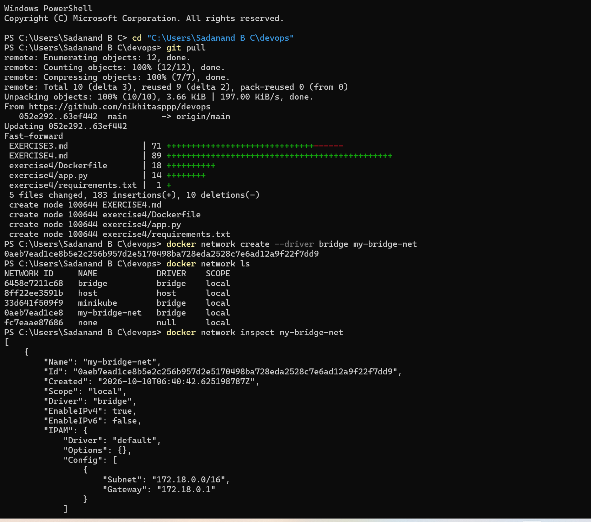
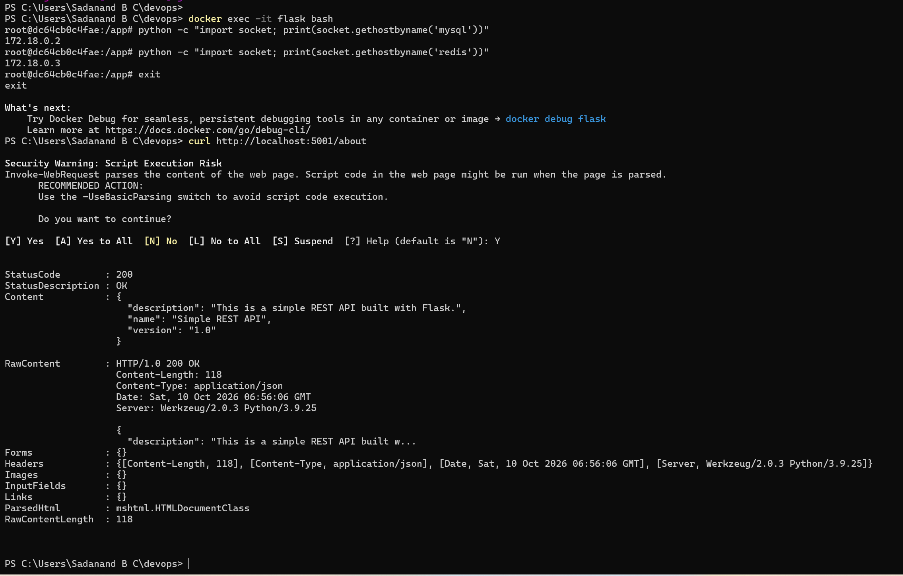

# Exercise 4: Docker Networking

**Goal:** Understand Docker networking by running a multi-container app — a Flask web server, a MySQL database, and a Redis cache — all on a custom bridge network, and verify they can reach each other by container name.

## Files
- [`exercise4/app.py`](exercise4/app.py) — minimal Flask REST API (`/about` endpoint)
- [`exercise4/requirements.txt`](exercise4/requirements.txt) — pins Flask
- [`exercise4/Dockerfile`](exercise4/Dockerfile) — builds the Flask app

## Steps

1. Create a custom bridge network:
   ```bash
   docker network create --driver bridge my-bridge-net
   ```

2. Verify it exists:
   ```bash
   docker network ls
   ```

3. Inspect it (shows subnet/gateway):
   ```bash
   docker network inspect my-bridge-net
   ```

4. Build the Flask image:
   ```bash
   cd exercise4
   docker build -t flask-api .
   cd ..
   ```

5. Launch all three containers on the same network:
   ```bash
   docker run -d --name mysql --net=my-bridge-net -e MYSQL_ROOT_PASSWORD=root mysql:latest
   docker run -d --name redis --net=my-bridge-net redis:latest
   docker run -d --name flask --net=my-bridge-net -p 5001:5001 flask-api
   ```

6. Test connectivity from inside the Flask container — exec in and ping the others by name:
   ```bash
   docker exec -it flask bash
   # inside the container:
   ping mysql
   ping redis
   exit
   ```

7. Test the Flask API itself from the host:
   ```bash
   curl http://localhost:5001/about
   ```

8. Clean up:
   ```bash
   docker stop mysql redis flask
   docker rm mysql redis flask
   docker network rm my-bridge-net
   ```

## Result

**1. Create bridge network:**
```
PS> docker network create --driver bridge my-bridge-net
0aeb7ead1ce8b5e2c256b957d2e5170498ba728eda2528c7e6ad12a9f22f7dd9
```

**2. Verify:**
```
PS> docker network ls
NETWORK ID     NAME            DRIVER    SCOPE
6458e7211c68   bridge          bridge    local
8ff22ee3591b   host            host      local
33d641f509f9   minikube        bridge    local
0aeb7ead1ce8   my-bridge-net   bridge    local
fc7eaae87686   none            null      local
```

**3. Inspect:**
```
PS> docker network inspect my-bridge-net
[
    {
        "Name": "my-bridge-net",
        "Id": "0aeb7ead1ce8b5e2c256b957d2e5170498ba728eda2528c7e6ad12a9f22f7dd9",
        "Created": "2026-10-10T06:40:42.625198787Z",
        "Driver": "bridge",
        "EnableIPv4": true,
        "EnableIPv6": false,
        "IPAM": {
            "Driver": "default",
            "Config": [
                { "Subnet": "172.18.0.0/16", "Gateway": "172.18.0.1" }
            ]
        }
    }
]
```



**4-5. Build and launch all three containers:**
```
PS> docker build -t flask-api .
PS> docker run -d --name mysql --net=my-bridge-net -e MYSQL_ROOT_PASSWORD=root mysql:latest
PS> docker run -d --name redis --net=my-bridge-net redis:latest
PS> docker run -d --name flask --net=my-bridge-net -p 5001:5001 flask-api

PS> docker ps -a
CONTAINER ID   IMAGE       STATUS          NAMES
a7f54cf86b57   flask-api   Up              flask
7b97653ce905   redis:latest   Up           redis
0820c01841c9   mysql:latest   Up           mysql
```

Hit a real bug here the first time: `flask` kept showing `Exited (1)`. `docker logs flask` showed:
```
ImportError: cannot import name 'url_quote' from 'werkzeug.urls'
```
Root cause: `requirements.txt` pinned `Flask==2.0.1` but left `Werkzeug` unpinned, so pip installed the newest `Werkzeug`, which had removed `url_quote` that Flask 2.0.1 depends on. Fixed by pinning `Werkzeug==2.0.3` alongside Flask in `exercise4/requirements.txt`, rebuilt, and `flask` came up clean on the next run.

**6. Test connectivity from inside the Flask container.**
`python:3.9-slim` has no `ping` binary, so used the documented DNS-resolution fallback instead:
```
PS> docker exec -it flask bash
root@dc64cb0c4fae:/app# python -c "import socket; print(socket.gethostbyname('mysql'))"
172.18.0.2
root@dc64cb0c4fae:/app# python -c "import socket; print(socket.gethostbyname('redis'))"
172.18.0.3
root@dc64cb0c4fae:/app# exit
```
Both container names resolved to their IPs on `my-bridge-net`, confirming they can find each other over the network.

**7. Test the Flask API from the host:**
```
PS> curl http://localhost:5001/about
StatusCode        : 200
StatusDescription : OK
Content           : {
                        "description": "This is a simple REST API built with Flask.",
                        "name": "Simple REST API",
                        "version": "1.0"
                    }
```



## Notes

- Added `-e MYSQL_ROOT_PASSWORD=root` to the `mysql` run command (not in the original exercise text) — the official `mysql` image refuses to start without a root password set.
- Added `host='0.0.0.0'` to `app.run()` in `app.py` (the original exercise code omits it) — Flask defaults to binding `127.0.0.1` inside the container, which is unreachable from outside even with `-p 5001:5001`. `0.0.0.0` means "listen on all interfaces inside the container."
- **Real bug hit:** pinning `Flask==2.0.1` without also pinning `Werkzeug` broke the build — pip grabbed the latest Werkzeug, which had removed `url_quote` that this old Flask version imports. Fix: pin `Werkzeug==2.0.3` too in `requirements.txt`.
- **Possible snag:** `python:3.9-slim` doesn't include the `ping` command by default. If `ping mysql` fails with "command not found" inside the Flask container, either install it first (`apt-get update && apt-get install -y iputils-ping`) or test connectivity a lighter way instead:
  ```bash
  python3 -c "import socket; print(socket.gethostbyname('mysql'))"
  python3 -c "import socket; print(socket.gethostbyname('redis'))"
  ```
  A successful DNS resolution (an IP comes back) proves the containers can find each other on the network, which is the actual point of the exercise.

## Q&A

**Q1. What is the purpose of the `--net` flag in `docker run`?**
A: It connects the container to a specific Docker network instead of the default bridge — containers on the same named network can reach each other by container name.

**Q2. How do containers communicate with each other on the same network?**
A: By container name — Docker runs an embedded DNS server on user-defined networks that resolves container names to their internal IPs.

**Q3. What is the difference between a bridge network and a host network?**
A: A bridge network gives containers their own isolated network namespace with virtual IPs, reachable from the host only through published ports (`-p`). A host network skips that isolation entirely — the container shares the host's network stack directly, so there's no port mapping needed but also no isolation.

**Q4. How can you expose a container's port to the host machine?**
A: The `-p <host-port>:<container-port>` flag on `docker run` (here, `-p 5001:5001` for the Flask container).
