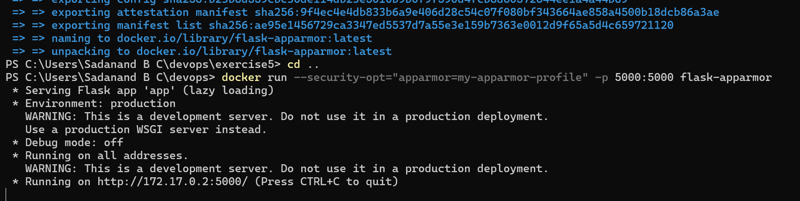
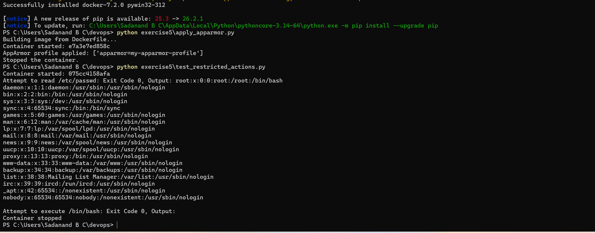

# Exercise 5: Docker Security with AppArmor

**Goal:** Containerize a Flask app, write a custom AppArmor profile that denies access to sensitive directories and binary execution, apply it via `--security-opt` and the Docker SDK for Python, then verify the restrictions actually hold by trying the denied actions.

## Files
- [`exercise5/app.py`](exercise5/app.py) — minimal Flask app ("Hello, this is a secure Flask application...")
- [`exercise5/requirements.txt`](exercise5/requirements.txt) — pins Flask/Werkzeug
- [`exercise5/Dockerfile`](exercise5/Dockerfile) — builds the Flask app
- [`exercise5/my-apparmor-profile`](exercise5/my-apparmor-profile) — the AppArmor profile from the exercise (denies `/etc/**`, `/var/**`, execution in `/bin`, `/usr/bin`, `cap_sys_admin`)
- [`exercise5/apply_apparmor.py`](exercise5/apply_apparmor.py) — Docker SDK script: builds the image, runs the container with the profile, inspects `HostConfig.SecurityOpt`
- [`exercise5/test_restricted_actions.py`](exercise5/test_restricted_actions.py) — Docker SDK script: tries `cat /etc/passwd` and `/bin/bash` inside the restricted container

## Steps

1. Build the image:
   ```bash
   cd exercise5
   docker build -t flask-apparmor .
   cd ..
   ```

2. Check whether the Docker host actually supports AppArmor before trying to use it:
   ```bash
   docker info
   ```
   Look at the `Security Options:` block.

3. Run the container with the profile attached directly:
   ```bash
   docker run --security-opt="apparmor=my-apparmor-profile" -p 5000:5000 flask-apparmor
   ```

4. Apply the profile via the Docker SDK and inspect the result:
   ```bash
   pip install docker
   python exercise5/apply_apparmor.py
   ```

5. Test whether the denied actions are actually blocked:
   ```bash
   python exercise5/test_restricted_actions.py
   ```

## Result

**Step 2 — `docker info`:**
```
Security Options:
 seccomp
  Profile: builtin
 cgroupns
Kernel Version: 6.18.40.1-microsoft-standard-WSL2
OSType: linux
```
No `apparmor` entry under Security Options — the first sign that AppArmor isn't available here at all.

**Step 1/3 — build + direct `docker run` with the profile attached:**
```
PS> docker build -t flask-apparmor .
[...build output, succeeded...]

PS> docker run --security-opt="apparmor=my-apparmor-profile" -p 5000:5000 flask-apparmor
 * Serving Flask app 'app' (lazy loading)
 * Environment: production
   WARNING: This is a development server. Do not use it in a production deployment.
   Use a production WSGI server instead.
 * Debug mode: off
 * Running on all addresses.
 * Running on http://172.17.0.2:5000/ (Press CTRL+C to quit)
```


No error at all, despite `my-apparmor-profile` never having been loaded anywhere (there's no `apparmor_parser` step possible — more on that below). The app just started normally.

**Step 4 — `apply_apparmor.py`:**
```
Building image from Dockerfile...
Container started: e7a3e7ed858c
AppArmor profile applied: ['apparmor=my-apparmor-profile']
Stopped the container.
```
Docker's own API reports the profile as "applied" in `HostConfig.SecurityOpt` — this is just Docker echoing back the flag it was given, not confirmation that anything was enforced.

**Step 5 — `test_restricted_actions.py` (the real test):**
```
Container started: 075cc4158afa
Attempt to read /etc/passwd: Exit Code 0, Output: root:x:0:0:root:/root:/bin/bash
daemon:x:1:1:daemon:/usr/sbin:/usr/sbin/nologin
...
nobody:x:65534:65534:nobody:/nonexistent:/usr/sbin/nologin

Attempt to execute /bin/bash: Exit Code 0, Output:
Container stopped
```



The exercise's own "Expected Output" for this script is `Exit Code 1` for `/etc/passwd` and `Exit Code 126` for `/bin/bash` (both denied). What we actually got was `Exit Code 0` for both — `/etc/passwd` printed in full, and `/bin/bash` ran without any complaint. **Neither restriction was enforced.**

## Why this happened (real finding, not a mistake)

This exercise assumes a native Linux host with the `apparmor` kernel module and `apparmor_parser` available (the prerequisites section literally says `sudo apt-get install apparmor-utils`). Docker Desktop on Windows doesn't run containers on a native Linux kernel — it runs them inside a lightweight Linux VM over WSL2, using Microsoft's stock WSL2 kernel (`6.18.40.1-microsoft-standard-WSL2` here). That kernel does not compile in the AppArmor LSM (Linux Security Module) at all, which is confirmed directly by `docker info` never listing `apparmor` under Security Options, on any Docker Desktop for Windows installation.

Practically, this also means Task 3's instruction to save the profile at `/etc/apparmor.d/my-apparmor-profile` and run `sudo apparmor_parser -r ...` has no real target on Windows — there's no AppArmor-aware host filesystem to put it on, and `apparmor_parser` isn't installable on the WSL2 VM Docker Desktop manages for you (it's not a general-purpose Linux distro you administer directly).

Docker's behavior when asked to apply a profile on a host with no AppArmor support is to accept the flag silently rather than error — it doesn't validate that the named profile exists or that enforcement is even possible on this host. That's why `HostConfig.SecurityOpt` happily reports `['apparmor=my-apparmor-profile']` even though nothing was ever loaded or enforced — confirmed directly by `test_restricted_actions.py` succeeding at both actions the profile was supposed to block.

**What this exercise would need to actually work:** a real Linux host (bare metal, a VM like VirtualBox/Hyper-V running actual Ubuntu, or a cloud Linux instance) with the `apparmor` kernel module enabled and `apparmor-utils` installed, so `apparmor_parser` has somewhere real to load the profile and the kernel has something to enforce it with.

## Q&A

**Q1. What is the purpose of using AppArmor with Docker containers?**
A: AppArmor enforces mandatory access control policies that confine what a containerized process can do — which files it can read/write, which binaries it can execute, which network/capability operations it can perform — independent of whatever the application code itself tries to do. It's a second layer of defense: even if the app is compromised, AppArmor limits the blast radius.

**Q2. How do AppArmor profiles help secure a Docker container?**
A: A profile explicitly allows or denies file paths, execution permissions, network access and Linux capabilities for a given binary. Docker attaches a profile to a container at `docker run` time via `--security-opt apparmor=<profile>`; the kernel then enforces it for every process inside that container, regardless of what the container image itself permits.

**Q3. Why is it important to restrict access to sensitive directories such as `/etc/` and `/var/`?**
A: `/etc/` holds system and application configuration (including credentials, user accounts like `/etc/passwd`/`/etc/shadow`), and `/var/` holds logs, package state and application data. A compromised container that can freely read or write these can exfiltrate secrets, tamper with configuration, or persist malicious state — restricting access limits what an attacker gains even after breaking into the container.

**Q4. What other capabilities can you restrict using AppArmor profiles?**
A: Network access and specific socket types (`network inet stream`), binding to privileged ports, executing binaries in specific paths (`deny /bin/** rmix`), mounting filesystems, raw socket access, and individual Linux capabilities like `cap_sys_admin`, `cap_net_raw`, or `cap_sys_ptrace` — each capability can be explicitly allowed or denied.

**Q5. How can you verify if an AppArmor profile is successfully applied to a Docker container?**
A: `docker inspect <container>` (or the Docker SDK's `client.api.inspect_container()`) shows the requested profile under `HostConfig.SecurityOpt`. **Important caveat we found directly in this exercise:** that field only reflects what was *requested* at `docker run` time, not whether it's actually *enforced*. The only real verification is testing the denied actions themselves (as `test_restricted_actions.py` does) and confirming the host supports AppArmor in the first place via `docker info`'s `Security Options` — on a host without AppArmor, the flag is accepted but silently has no effect, which is exactly what this run demonstrated.
