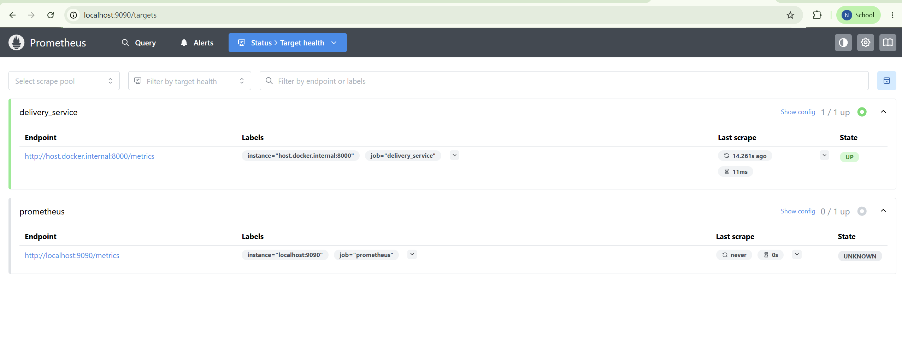
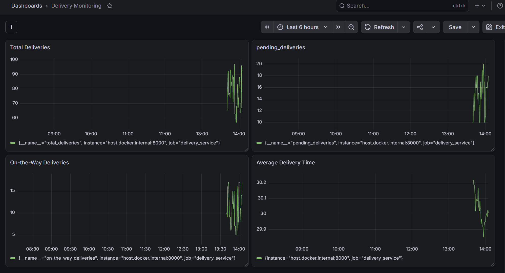
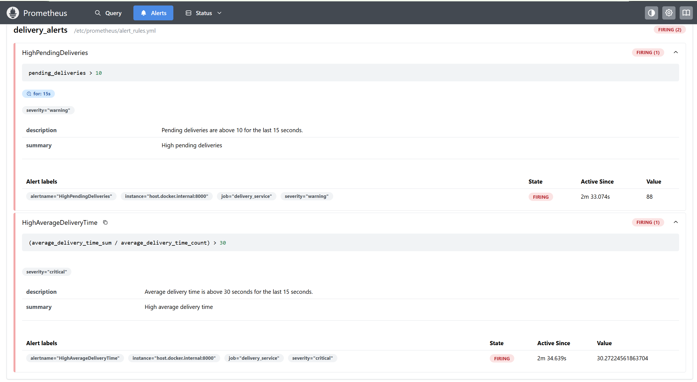
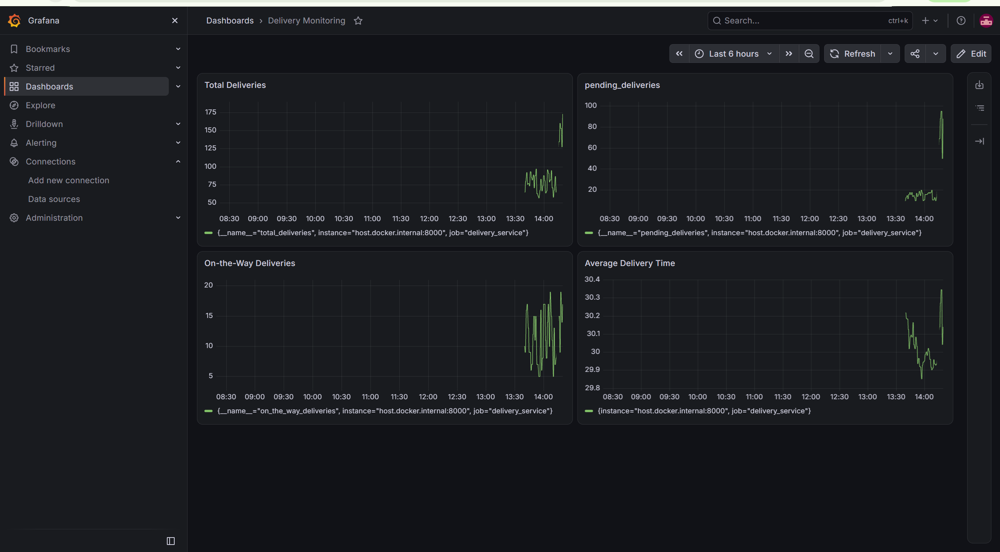

# Exercise 6: Real-Time Monitoring and Alerting (Delivery Metrics)

**Scenario:** As a DevOps engineer for a delivery service, build a monitoring pipeline that simulates live delivery metrics (Python + `prometheus_client`), scrapes them with Prometheus, visualizes them on a Grafana dashboard, and fires an alert when operations degrade (too many pending deliveries, or average delivery time too high).

## Files
- [`exercise6/delivery_metrics.py`](exercise6/delivery_metrics.py) — Flask-free HTTP server exposing 4 Prometheus metrics (`total_deliveries`, `pending_deliveries`, `on_the_way_deliveries`, `average_delivery_time`), updated once a second with simulated values
- [`exercise6/requirements.txt`](exercise6/requirements.txt) — pins `prometheus-client`
- [`exercise6/prometheus.yml`](exercise6/prometheus.yml) — scrape config for Prometheus
- [`exercise6/alert_rules.yml`](exercise6/alert_rules.yml) — two alert rules: `HighPendingDeliveries` (>10 for 15s) and `HighAverageDeliveryTime` (>30s average for 15s)

**Scope note:** the original exercise also folds in a Jenkins pipeline (its own Step 5) to automate building/running these containers. Exercises 7–9 of this course are dedicated Jenkins exercises covering that exact ground, so this write-up covers the metrics → Prometheus → Grafana → alerting chain only; Jenkins automation of this pipeline will be wired in when we get to Exercise 7.

## Windows / Docker Desktop deviations from the original exercise

The original exercise text uses `docker run --network=host` and hardcodes the Prometheus scrape target as `172.17.0.1:8000` (the native-Linux `docker0` bridge gateway IP). Neither works as written on Docker Desktop for Windows:

- `--network=host` only fully replicates the real host's network stack on native Linux — Docker Desktop runs containers inside a Linux VM, so "host" networking there means the VM, not Windows itself. This is a documented Docker Desktop limitation.
- `172.17.0.1` is the IP of a `docker0` interface that exists on native Linux. There's no such interface reachable from a Windows host the same way.

The exercise's own notes section actually says which alternative to use on Windows: `host.docker.internal`, which Docker Desktop provides specifically to let a container reach services running on the host machine, regardless of platform. So:

- `prometheus.yml`'s `delivery_service` scrape target is `host.docker.internal:8000` (reaching the Python script, which runs directly on Windows, not in a container) instead of `172.17.0.1:8000`.
- Prometheus and Grafana run on a custom bridge network (`monitoring-net`, same pattern taught in Exercise 4) instead of `--network=host`, and reach each other by container name (`http://prometheus:9090` from Grafana) rather than via published localhost ports.

## Steps

1. Install the Python dependency and run the metrics simulator:
   ```bash
   cd exercise6
   pip install -r requirements.txt
   python delivery_metrics.py
   ```

2. Confirm the metrics endpoint is live:
   ```bash
   curl http://localhost:8000/metrics
   ```

3. Create a bridge network and bring up Prometheus + Grafana on it:
   ```bash
   docker network create monitoring-net
   docker run -d --name prometheus --network=monitoring-net -p 9090:9090 -v ${PWD}/prometheus.yml:/etc/prometheus/prometheus.yml -v ${PWD}/alert_rules.yml:/etc/prometheus/alert_rules.yml prom/prometheus
   docker run -d --name grafana --network=monitoring-net -p 3000:3000 grafana/grafana
   ```

4. Verify Prometheus is scraping the metrics endpoint: `http://localhost:9090` → Status → Targets.

5. In Grafana (`http://localhost:3000`, login `admin`/`admin`): add Prometheus as a data source at `http://prometheus:9090` (container-name resolution on `monitoring-net`), then build a dashboard with 4 panels:
   - Total Deliveries → `total_deliveries`
   - Pending Deliveries → `pending_deliveries`
   - On-the-Way Deliveries → `on_the_way_deliveries`
   - Average Delivery Time → `average_delivery_time_sum / average_delivery_time_count`

6. Simulate an alert: edit `delivery_metrics.py` to push `pending_deliveries` above the alert threshold (`random.randint(50, 100)` instead of `random.randint(10, 20)`), restart the script, and watch `http://localhost:9090/alerts`.

## Result

**Step 2 — metrics endpoint confirmed live:**
```
PS> curl http://localhost:8000/metrics
StatusCode        : 200
Content           : # HELP python_gc_objects_collected_total Objects collected during gc
                     # TYPE python_gc_objects_collected_total counter
                     python_gc_objects_collected_total{generation="0"} 0.0
                     ...
```
And the script's own debug output confirmed values updating every second, e.g.:
```
[DEBUG] Total deliveries: 89
[DEBUG] Pending deliveries: 15
[DEBUG] On-the-way deliveries: 15
[DEBUG] Average delivery time: 32.18 seconds
```

**Step 3 — bringing up the containers hit a real snag first.** The very first attempt ran the `docker network create monitoring-net` command, but then both `docker run` commands for Prometheus and Grafana failed with:
```
docker: Error response from daemon: failed to set up container networking: network monitoring-net not found
```
`docker ps -a` showed both containers stuck in status `Created` (never actually started) — the network never actually got created before those commands ran. Fixed by removing the two half-created containers, re-running `docker network create monitoring-net`, confirming it in `docker network ls`, and re-running both `docker run` commands — this time both showed `Up`.

**Step 4 — Prometheus Targets page**, confirming the `delivery_service` job is scraping `host.docker.internal:8000` successfully:



**Step 5 — Grafana dashboard**, all 4 panels live with real data from the running script:



One bug caught and fixed along the way: the first version of the "Average Delivery Time" panel showed values in the 20,000–60,000 range — way outside the expected 15-45 second range. The query had only picked up `average_delivery_time_sum` (the raw, ever-growing cumulative sum from the Prometheus `Summary` type) instead of the full division `average_delivery_time_sum / average_delivery_time_count`. Re-entering the full query fixed it — the panel then correctly showed ~29.9-30.2, and its legend correctly dropped the `__name__` label (since dividing two differently-named series removes it), confirming the division was actually being computed.

**Step 6 — triggering the alert.** First attempt at editing `delivery_metrics.py` didn't actually take effect (the script's debug output still showed the original 10-20 range after a "restart" — the edit hadn't been saved, or the old process was still running). Fixed by explicitly stopping the script, using Notepad's Find & Replace to make the edit, confirming it saved, and restarting — the debug output then showed the new 50-100 range.

Once that took, both alert rules fired for real:

```
HighPendingDeliveries    FIRING   value: 88    active: 2m33s
HighAverageDeliveryTime  FIRING   value: 30.27 active: 2m34s
```



Note `HighPendingDeliveries` briefly sat in `PENDING` state (not yet `FIRING`) even though the metric had already been above 10 continuously for well over the rule's `for: 15s` duration — this is because Prometheus's rule evaluation interval (not set explicitly in `prometheus.yml`, so it uses the default) is coarser than 15s, so the state transition only happens on the next evaluation tick rather than instantly at the 15-second mark.

And the Grafana dashboard reflecting the same spike live:



## Expected Outputs — confirmed

1. **Metrics Endpoint:** `http://localhost:8000/metrics` — confirmed live, returning current state of all 4 metrics.
2. **Prometheus Query:** graphs for `total_deliveries`, `pending_deliveries`, `average_delivery_time` — confirmed via Prometheus's own Targets/scrape and Grafana panels.
3. **Grafana Dashboard:** visualizations for all 4 delivery metrics — confirmed, "Delivery Monitoring" dashboard with 4 live panels.
4. **Jenkins Logs:** out of scope for this write-up — see the note above; will be covered when Exercises 7-9 wire Jenkins into this pipeline.
5. **Prometheus Alerts:** critical alert for high pending deliveries — confirmed, both `HighPendingDeliveries` and `HighAverageDeliveryTime` reached `FIRING` state with real values.
