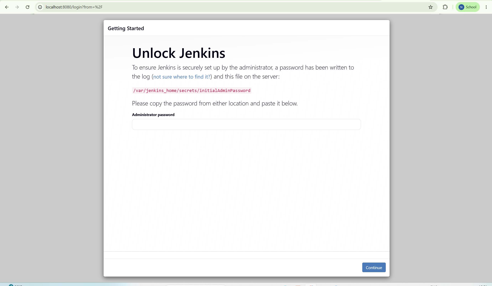
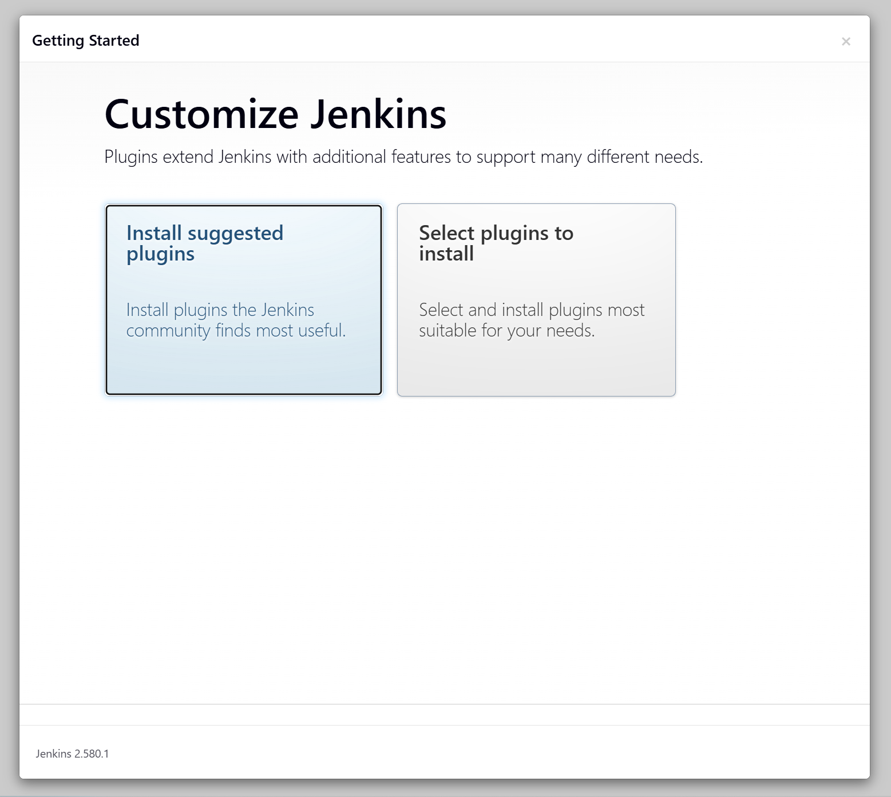
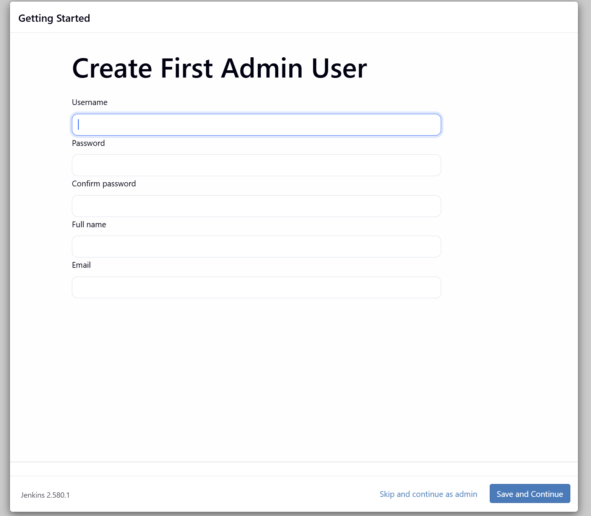
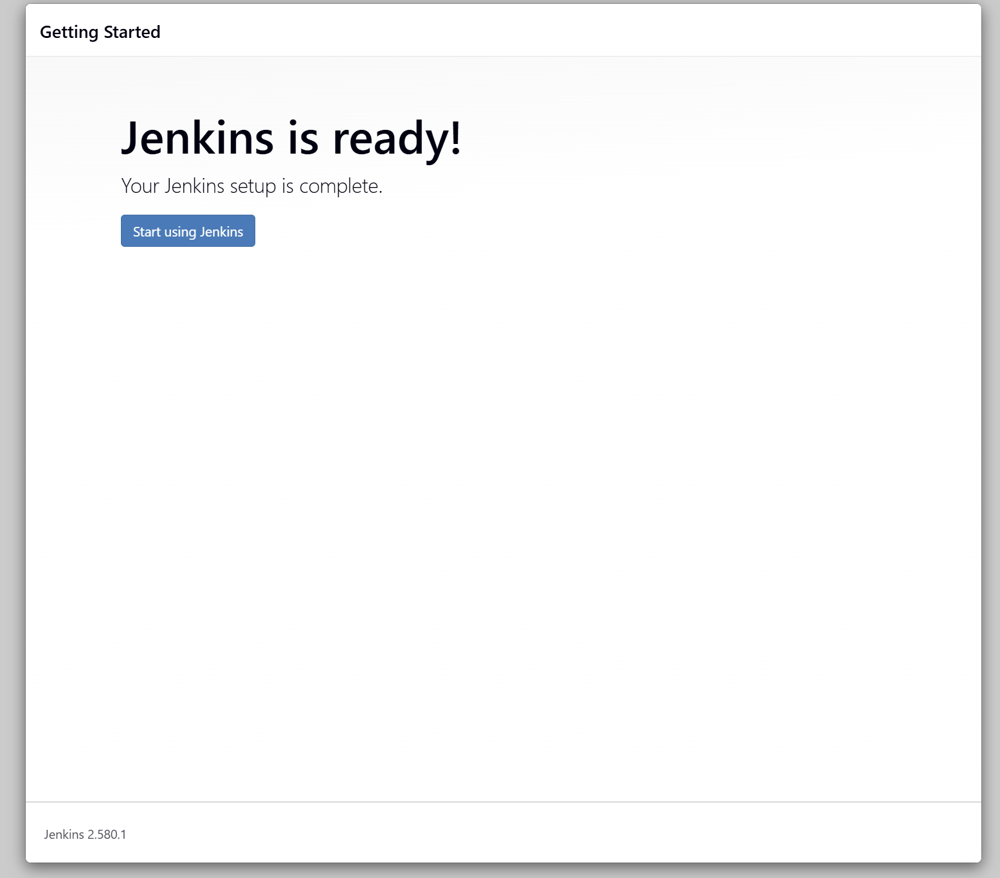
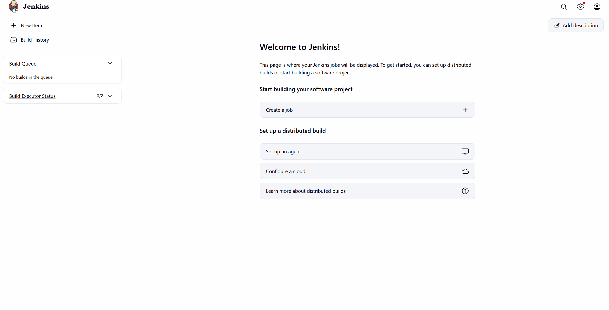

# Exercise 7: Introduction to Continuous Integration (CI) and Jenkins Installation

**Scenario:** Get a CI server running so later exercises have something to build pipelines on. This exercise covers what CI is and why teams use it, a quick survey of CI tools, and the actual hands-on piece: install Jenkins via Docker and get through its first-run setup wizard to a working dashboard.

**Scope note:** The real exercise content here is Jenkins *installation and setup only* — pulling the image, running the container, unlocking Jenkins, and landing on a clean dashboard. It does not build a job or pipeline (that's Exercises 8 and 9). Exercise 6's write-up said Jenkins automation of the delivery-metrics pipeline would be "wired in when we get to Exercise 7" — that was premature on my part. The actual tie-in happens once a real job/pipeline exists, which lands properly in Exercise 8 (Hello World Job) or 9 (Multi-Stage Pipeline).

## Steps

1. Run Jenkins in a container, with a named volume so Jenkins' state (plugins, config, the admin user) survives a container restart:
   ```bash
   docker run -d --name jenkins -p 8080:8080 -p 50000:50000 -v jenkins_home:/var/jenkins_home jenkins/jenkins:lts
   ```
   (The course manual's version of this command skips the `-v` volume mount. Adding it means `docker stop`/`docker start jenkins` later won't lose the setup — worth keeping.)

2. Confirm the container is up:
   ```bash
   docker ps -a
   ```

3. Retrieve the initial admin password Jenkins generated on first boot:
   ```bash
   docker exec jenkins cat /var/jenkins_home/secrets/initialAdminPassword
   ```

4. Open `http://localhost:8080/` and go through the first-run wizard: Unlock Jenkins (paste the password from step 3) → Customize Jenkins (install suggested plugins) → Create First Admin User → Instance Configuration → "Jenkins is ready!" → dashboard.

## Notes — Windows / Docker Desktop

The very first attempt at step 1 failed before Jenkins ever started pulling:
```
failed to connect to the docker API at npipe:////./pipe/dockerDesktopLinuxEngine; check if the path is correct and if the daemon is running: open //./pipe/dockerDesktopLinuxEngine: The system cannot find the file specified.
```
`docker ps -a` failed with the identical error right after. This isn't a Docker *command* problem — it means the Docker Desktop application itself wasn't running yet, so there was no daemon behind the `docker` CLI to talk to. Fixed by opening Docker Desktop from the Start menu, waiting for the whale icon in the system tray to stop animating (~30-60s), confirming readiness with `docker info`, then re-running the original `docker run` command — which then worked cleanly.

## Result

**Step 1 — image pull and container start:**
```
PS C:\WINDOWS\system32> docker run -d --name jenkins -p 8080:8080 -p 50000:50000 -v jenkins_home:/var/jenkins_home jenkins/jenkins:lts
Unable to find image 'jenkins/jenkins:lts' locally
lts: Pulling from jenkins/jenkins
a91427fe0e3f: Pull complete
6eefb2f5d3e9: Pull complete
d89089c8a5a3: Pull complete
810008851f3a: Pull complete
463a574793f8: Pull complete
95bc7464aaea: Pull complete
a20a14499a3e: Pull complete
968c36a3b2c5: Pull complete
f9e31fab50e8: Pull complete
408777b27aa9: Pull complete
701ded2f9b33: Pull complete
3dd4a99993ab: Pull complete
44136fa355b3: Already exists
9613b4f6b0c7: Download complete
Digest: sha256:a660310e39ade10631f774bacd5219de767dfd08947ea5c32a739b5e5bb382c1
Status: Downloaded newer image for jenkins/jenkins:lts
17a62e1a499e4b905f5069d90d76a875b47ded55d0dee2df09e51afa5a95f73
```

**Step 2 — `docker ps -a` confirming `jenkins` is `Up`, ports mapped correctly:**
```
CONTAINER ID   IMAGE                  COMMAND                  CREATED          STATUS          PORTS                                                                      NAMES
17a62e1a499e   jenkins/jenkins:lts    "/usr/bin/tini -- /u…"   53 seconds ago   Up 52 seconds   0.0.0.0:8080->8080/tcp, [::]:8080->8080/tcp, 0.0.0.0:50000->50000/tcp, [::]:50000->50000/tcp   jenkins
```

**Step 3 — initial admin password retrieved:**
```
PS C:\WINDOWS\system32> docker exec jenkins cat /var/jenkins_home/secrets/initialAdminPassword
9e29d4308a684f59b7fcda70bf64b3a1
```

**Step 4 — the full setup wizard, screenshot per stage:**

Unlock Jenkins, with the password from step 3 pasted in:



Customize Jenkins — chose "Install suggested plugins":



Create First Admin User:



"Jenkins is ready!":



Final dashboard — clean install, no jobs yet, 0/2 build executors, empty build queue:



Jenkins is version 2.580.1 throughout.

## Expected Outputs — confirmed

1. **Jenkins installed and running via Docker:** confirmed — container `jenkins` (`17a62e1a499e...`) up on ports 8080/50000, with a named volume (`jenkins_home`) for persistence.
2. **Initial admin password retrieved and setup wizard unlocked:** confirmed.
3. **Suggested plugins installed, first admin user created:** confirmed.
4. **Jenkins reachable at `http://localhost:8080/`, reporting "Jenkins is ready!" and landing on a working dashboard:** confirmed — empty "Welcome to Jenkins!" dashboard, ready for a job to be created.
