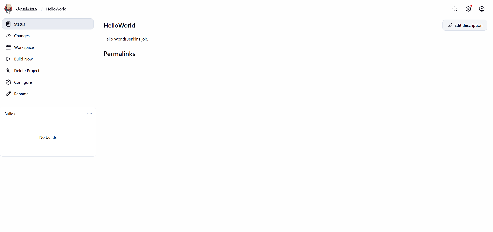
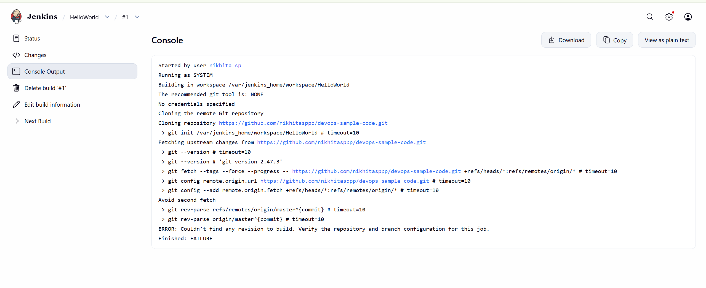
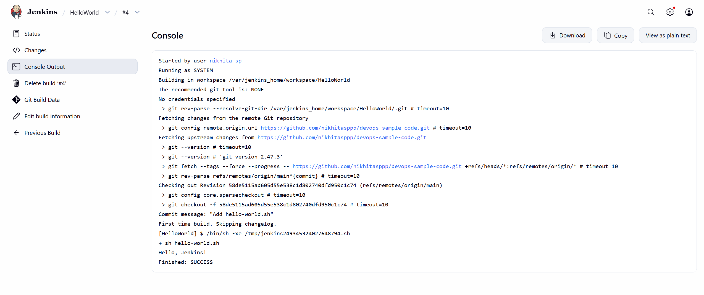

# Exercise 8: Jenkins Hello World Job

**Scenario:** Build the first real Jenkins job — a Freestyle project that pulls a script from a GitHub repo via the Git plugin and runs it as a build step, confirming Jenkins can actually do source-controlled CI, not just sit idle with an empty dashboard.

## Files
- [`exercise8/hello-world.sh`](exercise8/hello-world.sh) — copy of the script for reference. The authoritative version Jenkins actually builds from lives in a separate, dedicated public repo created for this exercise: [nikhitasppp/devops-sample-code](https://github.com/nikhitasppp/devops-sample-code) — that's the whole point of the exercise (a real external Git source Jenkins polls/clones), so it isn't folded into this repo.

## Steps

1. Create a new public GitHub repository `devops-sample-code` (no README/license, so the first local push creates the initial commit cleanly).
2. Locally, create `hello-world.sh`:
   ```bash
   #!/bin/bash
   echo "Hello, Jenkins!"
   ```
3. `git init`, `git add hello-world.sh`, `git commit -m "Add hello-world.sh"`.
4. `git remote add origin https://github.com/nikhitasppp/devops-sample-code.git`, then `git push -u origin main`.
5. In Jenkins (`http://localhost:8080`): **New Item** → name `HelloWorld` → **Freestyle project** → OK.
6. In the job config: add a description, set **Source Code Management** → **Git** → repository URL `https://github.com/nikhitasppp/devops-sample-code.git` (no credentials needed, public repo), add a **Build Step** → **Execute shell** → `sh hello-world.sh`, Save.
7. **Build Now**, then check **Console Output**.

## Notes — real bugs hit along the way

Three separate issues came up, in order:

1. **`mkdir` with a space in the username.** The Windows account is `Sadanand B C` (note the spaces), so `mkdir C:\Users\Sadanand B C\devops-sample-code` without quotes broke — PowerShell parsed `B` and `C\devops-sample-code` as extra positional arguments. Fixed by quoting the whole path: `mkdir "C:\Users\Sadanand B C\devops-sample-code"`.

2. **Script typed into the wrong window.** `notepad hello-world.sh` opens Notepad as a separate GUI window, but the `#!/bin/bash` and `echo "Hello, Jenkins!"` lines got typed into the still-focused PowerShell prompt instead of into that Notepad window. PowerShell silently treated `#!/bin/bash` as a comment and actually *ran* the `echo` command (printing `Hello, Jenkins!` to the terminal, which looked like progress but wasn't). Result: `hello-world.sh` was staged as a 0-byte file (`-a----  0 hello-world.sh` in a directory listing confirmed this). Caught it with `Get-Content hello-world.sh` returning nothing, then fixed it by reopening Notepad, actually clicking into that window, typing the two lines there, saving with Ctrl+S, and re-verifying with `Get-Content` before re-staging.

3. **`git commit` failed with "Author identity unknown."** This was a fresh repo on a machine where `user.name`/`user.email` had only ever been set locally in the other `devops` repo, not globally. Fixed with:
   ```
   git config --global user.email "nikhitasadanand.is23@bmsce.ac.in"
   git config --global user.name "Nikhita"
   ```
   After that, `git commit` succeeded, and the follow-on `git push -u origin main` authenticated via a browser popup (Git Credential Manager's OAuth device flow) rather than needing a manually pasted Personal Access Token.

4. **Jenkins build #1 failed — branch name mismatch.** Jenkins' Git plugin defaults "Branches to build" to `*/master`, but the repo's default branch (from `git push -u origin main`) is `main`. Console output:
   ```
   > git rev-parse refs/remotes/origin/master^{commit} # timeout=10
   > git rev-parse origin/master^{commit} # timeout=10
   ERROR: Couldn't find any revision to build. Verify the repository and branch configuration for this job.
   Finished: FAILURE
   ```
   Fixed in **Configure** → **Source Code Management** → **Branches to build**, changing `*/master` to `*/main`, then Save. Builds `#2` and `#3` were extra accidental clicks of "Build Now" while re-checking the fix had saved, not separate bugs.

## Result

**Local push (after fixing the identity issue):**
```
PS C:\Users\Sadanand B C\devops-sample-code> git commit -m "Add hello-world.sh"
[main (root-commit) 58de511] Add hello-world.sh
 1 file changed, 2 insertions(+)
 create mode 100644 hello-world.sh
PS C:\Users\Sadanand B C\devops-sample-code> git push -u origin main
info: please complete authentication in your browser...
Enumerating objects: 3, done.
Counting objects: 100% (3/3), done.
Writing objects: 100% (3/3), 268 bytes | 268.00 KiB/s, done.
Total 3 (delta 0), reused 0 (delta 0), pack-reused 0
To https://github.com/nikhitasppp/devops-sample-code.git
 * [new branch]      main -> main
branch 'main' set up to track 'origin/main'.
```

**Jenkins `HelloWorld` job created**, description set, no builds yet:



**Build #1 — failed** on the `master`/`main` branch mismatch (see Notes above):



**Build #4 — succeeded**, after fixing the branch specifier:
```
Cloning repository https://github.com/nikhitasppp/devops-sample-code.git
> git fetch --tags --force --progress -- https://github.com/nikhitasppp/devops-sample-code.git +refs/heads/*:refs/remotes/origin/* # timeout=10
> git rev-parse refs/remotes/origin/main^{commit} # timeout=10
Checking out Revision 58de5115ad605d55e538c1d802740dfd950c1c74 (refs/remotes/origin/main)
Commit message: "Add hello-world.sh"
[HelloWorld] $ /bin/sh -xe /tmp/jenkins249345324027648794.sh
+ sh hello-world.sh
Hello, Jenkins!
Finished: SUCCESS
```



## Expected Outputs — confirmed

1. **`devops-sample-code` GitHub repo with `hello-world.sh`:** confirmed, pushed to `main`, commit `58de511`.
2. **Jenkins Freestyle job `HelloWorld` configured with Git SCM + Execute shell build step:** confirmed.
3. **Build triggered via "Build Now":** confirmed — took 4 build attempts to get right, which is honestly a more useful record of what this step actually involves than a first-try success would be.
4. **Console output showing `Hello, Jenkins!` and `Finished: SUCCESS`:** confirmed, build `#4`.
