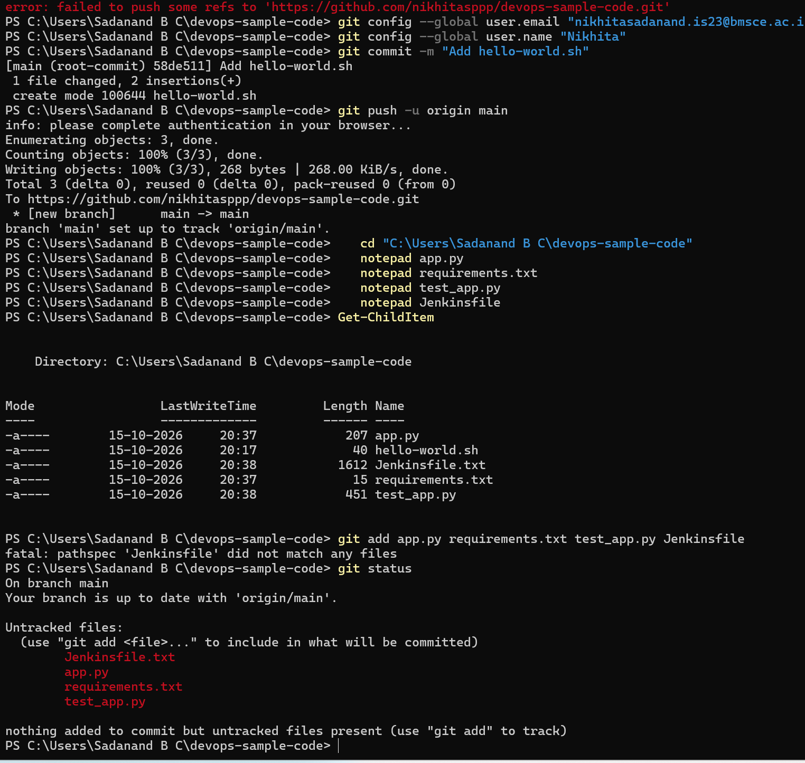
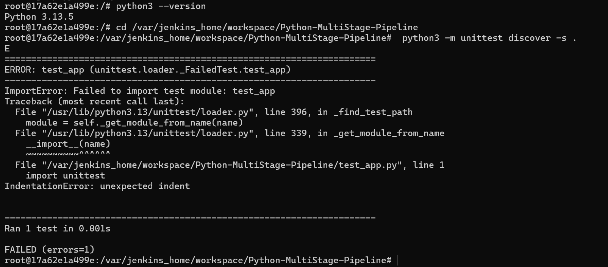
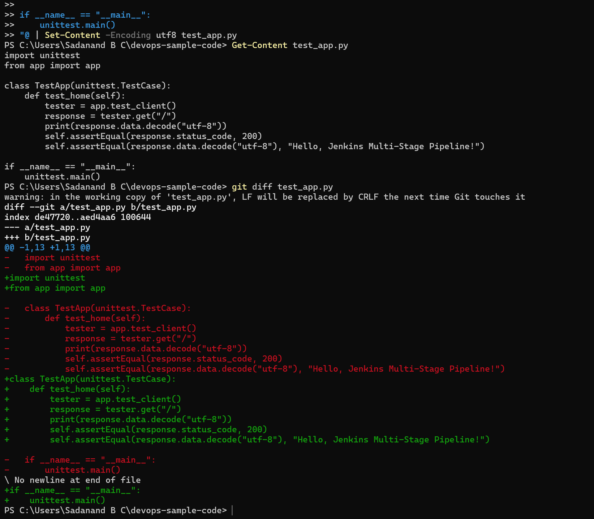
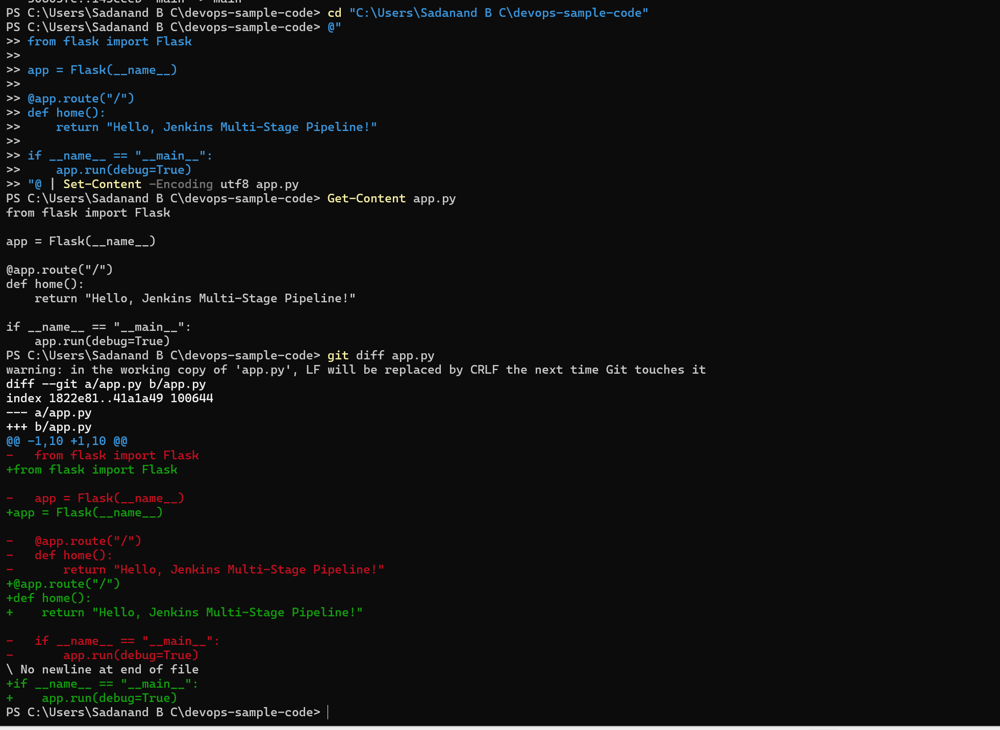
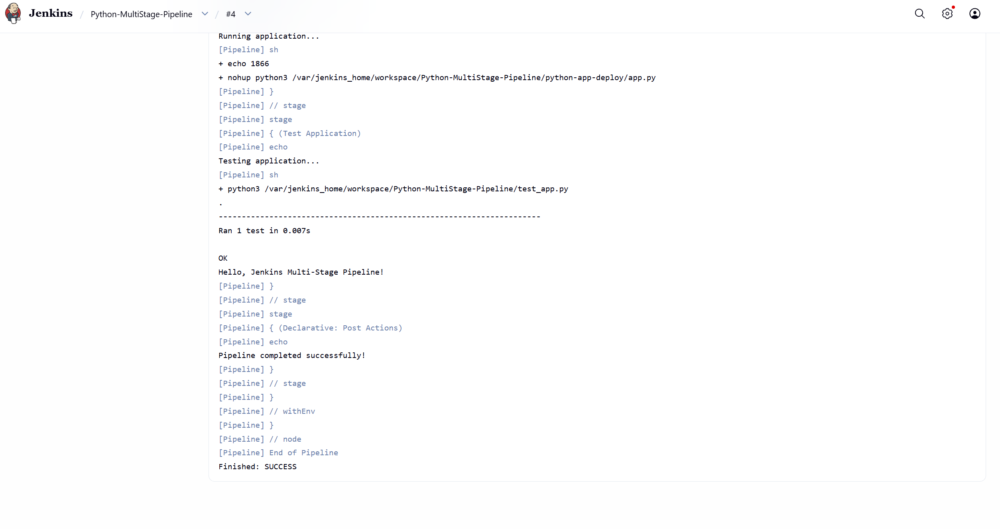
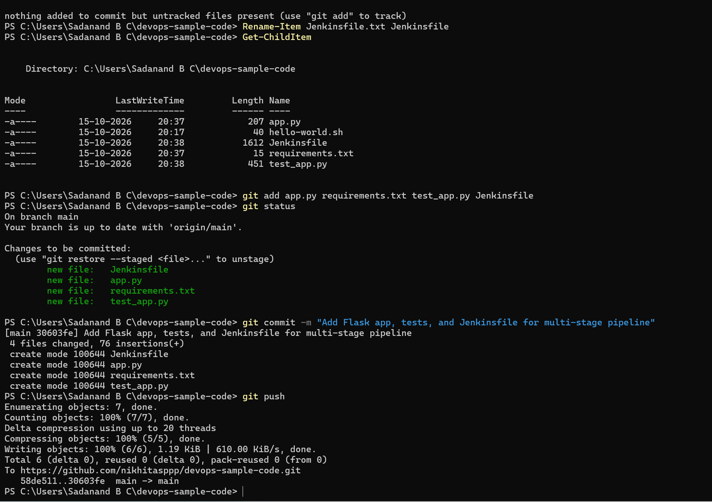

# Exercise 9: Jenkins Multi-Stage Pipeline

**Scenario:** Automate the CI/CD pipeline for a small Flask app with a real Jenkins **Pipeline** job (not Freestyle) driven by a `Jenkinsfile` checked into Git — five stages: Build, Test, Deploy, Run Application, Test Application.

## Files
- [`exercise9/app.py`](exercise9/app.py), [`exercise9/requirements.txt`](exercise9/requirements.txt), [`exercise9/test_app.py`](exercise9/test_app.py), [`exercise9/Jenkinsfile`](exercise9/Jenkinsfile) — copies for reference. The authoritative versions Jenkins actually builds from live at the root of the same [nikhitasppp/devops-sample-code](https://github.com/nikhitasppp/devops-sample-code) repo used in Exercise 8, alongside `hello-world.sh` — same reasoning as Exercise 8: the Jenkinsfile's `sh` steps reference `app.py`/`test_app.py` directly off `${WORKSPACE}`, which only works if they sit at the repo root rather than nested in a subfolder.

**Scope note:** the manual's Step 3 assumes a brand-new repo (fresh `git init`), but `devops-sample-code` already existed with real history from Exercise 8. Re-initializing it would have been wrong, so these four files were added directly into that existing repo instead.

## Steps

1. Add `app.py`, `requirements.txt`, `test_app.py` (Flask app + unit test) to the existing `devops-sample-code` repo, commit, push.
2. Write a `Jenkinsfile` with 5 declarative stages (Build, Test, Deploy, Run Application, Test Application) plus `post { success / failure }` blocks, add it to the same repo, commit, push.
3. In Jenkins: **New Item** → name `Python-MultiStage-Pipeline` → **Pipeline** (not Freestyle) → OK.
4. In the job config, under **Pipeline**, set **Definition** to **Pipeline script from SCM** → SCM: Git → Repository URL `https://github.com/nikhitasppp/devops-sample-code.git` → **Branches to Build**: `*/main` (not the default `*/master`) → **Script Path**: `Jenkinsfile`. Save.
5. **Build Now**, iterate on whatever breaks.

## Notes — four real bugs, in the order they were hit

1. **Notepad silently saved `Jenkinsfile` as `Jenkinsfile.txt`.** Same root cause as Exercise 8's branch-mismatch bug was different, but the same *class* of Windows surprise: Notepad appends `.txt` to any filename without a recognized extension unless "Save as type: All Files" is explicitly chosen. `git add Jenkinsfile` failed with `pathspec 'Jenkinsfile' did not match any files` until it was renamed back with `Rename-Item Jenkinsfile.txt Jenkinsfile`.

   

2. **Jenkins' container has no Python at all.** Build `#1` failed immediately in the Test stage:
   ```
   + python3 -m unittest discover -s .
   /var/jenkins_home/workspace/Python-MultiStage-Pipeline@tmp/durable-89476af0/script.sh.copy: 1: python3: not found
   ```
   This is a known, expected gap in the official `jenkins/jenkins:lts` image, not a mistake — the manual itself flags it. Fixed by shelling directly into the running container as root and installing what's missing:
   ```
   docker exec -it -u root jenkins bash
   apt-get update
   apt install -y python3
   apt install -y python3-pip
   apt install -y python3-flask
   ```
   One genuine hiccup here: `apt install -y python3-pip` pulled in a huge dependency chain (gcc, g++, build-essential, etc.) and failed partway through with `Error: Failed to fetch http://deb.debian.org/.../build-essential_12.12_amd64.deb 400 Bad Request` — a transient Debian mirror issue, not anything wrong with the command. It didn't matter in practice: `apt install -y python3-flask` (run as a separate command) succeeded independently and installed Flask as a system package, which is all `app.py`/`test_app.py` actually needed — `pip` itself was never required.

   

3. **`test_app.py` had a baked-in `IndentationError`.** With Python now present, build `#2` (same unchanged commit, since the first Notepad "fix" attempt had produced byte-identical content and `git commit` reported `nothing to commit, working tree clean`) failed with:
   ```
   File "/var/jenkins_home/workspace/Python-MultiStage-Pipeline/test_app.py", line 1
       import unittest
   IndentationError: unexpected indent
   ```
   Retyping it in Notepad a second time reproduced the exact same bug rather than fixing it. Fixed for real by bypassing Notepad entirely and writing the file from PowerShell with a here-string (`@"..."@ | Set-Content -Encoding utf8 test_app.py`), confirmed with `git diff` before committing:

   

   Pushed as commit `143ccebd`.

4. **Same bug, `app.py` this time.** With `test_app.py` fixed, build `#3` got one step further — past the `import test_app` line — and then failed importing `app.py` itself:
   ```
   File "/var/jenkins_home/workspace/Python-MultiStage-Pipeline/app.py", line 1
       from flask import Flask
   IndentationError: unexpected indent
   ```
   Same original cause (typed into Notepad back in Step 1), same fix: rewritten via PowerShell here-string, verified with `git diff` before committing:

   

   Pushed as commit `715de0c0`.

## Result

**Build `#1` — FAILURE, missing Python:**
```
+ python3 -m unittest discover -s .
/var/jenkins_home/workspace/Python-MultiStage-Pipeline@tmp/durable-89476af0/script.sh.copy: 1: python3: not found
ERROR: script returned exit code 127
Finished: FAILURE
```

**Build `#2` — FAILURE, `test_app.py` indentation (Python now present, got further):**
```
Checking out Revision 30603fe5ef8ce9afc8c28fc958a7e93f9ca3d602 (refs/remotes/origin/main)
...
+ python3 -m unittest discover -s .
E
ImportError: Failed to import test module: test_app
  File "/var/jenkins_home/workspace/Python-MultiStage-Pipeline/test_app.py", line 1
    import unittest
IndentationError: unexpected indent
FAILED (errors=1)
ERROR: script returned exit code 1
Finished: FAILURE
```

**Build `#3` — FAILURE, `app.py` indentation (test_app.py fixed, new commit `143ccebd`, got further still):**
```
Checking out Revision 143ccebdc0f9230eb3cb768d3a254a23c9c3003f (refs/remotes/origin/main)
Commit message: "Fix indentation error in test_app.py"
...
+ python3 -m unittest discover -s .
E
ImportError: Failed to import test module: test_app
  File "/var/jenkins_home/workspace/Python-MultiStage-Pipeline/test_app.py", line 2, in <module>
    from app import app
  File "/var/jenkins_home/workspace/Python-MultiStage-Pipeline/app.py", line 1
    from flask import Flask
IndentationError: unexpected indent
FAILED (errors=1)
ERROR: script returned exit code 1
Finished: FAILURE
```

**Build `#4` — SUCCESS, all 5 stages, new commit `715de0c0`:**
```
Checking out Revision 715de0c0224d99173f63a95d278590e1c6a82915 (refs/remotes/origin/main)
Commit message: "Fix indentation error in app.py"
...
[Pipeline] { (Test)
+ python3 -m unittest discover -s .
.
----------------------------------------------------------------------
Ran 1 test in 0.014s

OK
Hello, Jenkins Multi-Stage Pipeline!
[Pipeline] { (Deploy)
Deploying application...
+ mkdir -p /var/jenkins_home/workspace/Python-MultiStage-Pipeline/python-app-deploy
+ cp /var/jenkins_home/workspace/Python-MultiStage-Pipeline/app.py /var/jenkins_home/workspace/Python-MultiStage-Pipeline/python-app-deploy/
[Pipeline] { (Run Application)
Running application...
+ echo 1866
+ nohup python3 /var/jenkins_home/workspace/Python-MultiStage-Pipeline/python-app-deploy/app.py
[Pipeline] { (Test Application)
Testing application...
+ python3 /var/jenkins_home/workspace/Python-MultiStage-Pipeline/test_app.py
.
----------------------------------------------------------------------
Ran 1 test in 0.007s

OK
Hello, Jenkins Multi-Stage Pipeline!
[Pipeline] { (Declarative: Post Actions)
Pipeline completed successfully!
[Pipeline] End of Pipeline
Finished: SUCCESS
```



**Part 1 push (app.py, requirements.txt, test_app.py, Jenkinsfile all added to the existing repo, after fixing the Jenkinsfile.txt extension bug):**



## Expected Outputs — confirmed

1. **Build Stage installs dependencies:** the Jenkinsfile's actual Build stage only echoes a message (it never runs `pip install -r requirements.txt`, despite the manual's "Expected Outcome" section implying it does) — Flask ended up available because it was installed as a system package directly in the container (see Note 2), not through the pipeline itself. Noting this gap rather than glossing over it.
2. **Test Stage runs unit tests:** confirmed, `Ran 1 test in 0.014s — OK`, printing `Hello, Jenkins Multi-Stage Pipeline!`.
3. **Deploy Stage copies `app.py` to a deployment directory:** confirmed — `/var/jenkins_home/workspace/Python-MultiStage-Pipeline/python-app-deploy/app.py` (the manual's own text says `/tmp/python-app-deploy`, but the actual Jenkinsfile it provides uses `${WORKSPACE}/python-app-deploy`, which is what really ran).
4. **Full pipeline, all 5 stages, `Finished: SUCCESS`:** confirmed, build `#4`, after genuinely debugging through 3 failed builds first.
